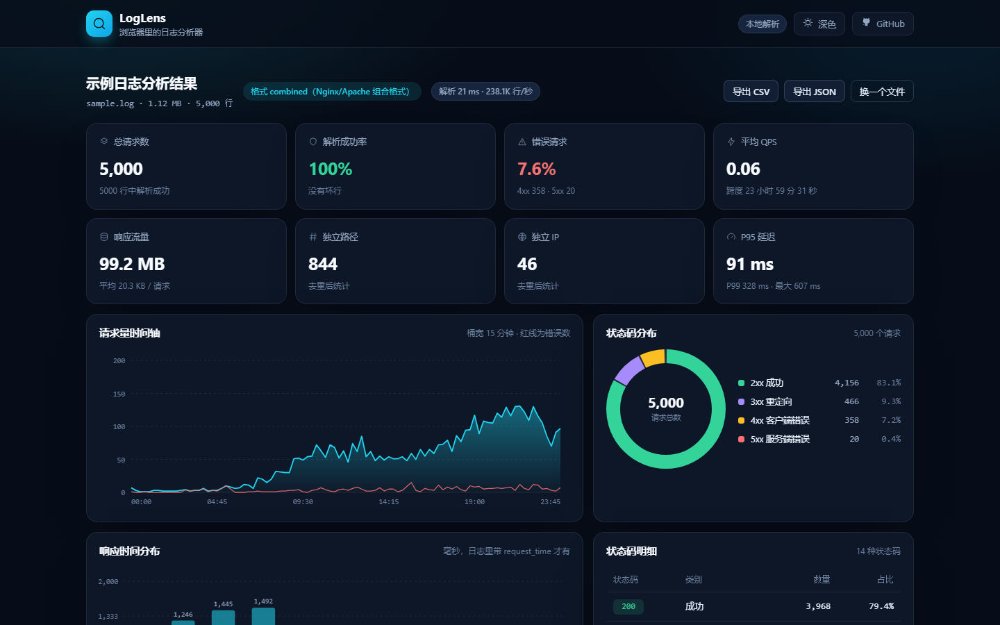
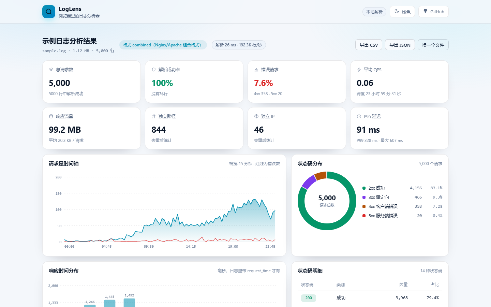
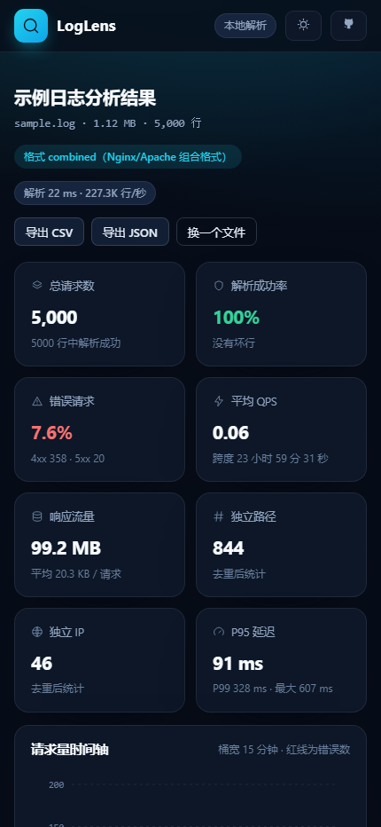

# LogLens

**把日志丢进浏览器，几秒看清线上发生了什么。**

Nginx / Apache / JSON 访问日志在本地解析、聚合、可视化：请求量、错误率、状态码分布、Top 路径与 IP、P50/P95/P99 延迟。没有后端、没有上报，日志不出浏览器。

[](https://github.com/pzj060726-png/loglens/actions/workflows/ci.yml)
[](https://github.com/pzj060726-png/loglens/actions/workflows/pages.yml)
[](LICENSE)
[](package.json)

**[在线体验](https://pzj060726-png.github.io/loglens/)** · **[示例日志](demo/sample.log)**（虚构电商站 24 小时访问日志，5,000 行）

---

## 截图

| 首页 | 分析结果（深色） |
| --- | --- |
|  |  |

| 浅色主题 | 移动端 |
| --- | --- |
|  |  |

## 功能

- **格式自动识别**：Nginx/Apache `combined`、`common`、JSON Lines，取前 20 行判定后锁定，坏行单独计数并保留原样样本，便于定位问题
- **流式读取 + Web Worker**：`File.stream()` 分块读、按行切开，解析在 Worker 里跑，主线程只更新进度条，几百 MB 的日志也不锁页面
- **概览一眼看完**：总请求数、解析成功率、错误率、平均 QPS、响应流量、独立路径、独立 IP、P95 延迟
- **四张图**：请求量时间轴（叠加错误曲线，桶宽自适应）、状态码分布甜甜圈、延迟直方图、状态码明细表
- **排行与分布**：Top 10 路径、Top 10 IP（带错误计数）、HTTP 方法分布
- **分位数**：P50 / P95 / P99 / 平均值，大文件走蓄水池抽样，内存恒定
- **明细可查**：保留 1,500 条样本，按路径 / IP / UA 搜索、按状态码类别过滤，表格最多渲染 200 行
- **导出**：CSV（汇总 + 状态码 + Top 路径 + Top IP + 时间轴，带 BOM，Excel 直接打开）与 JSON（含解析元信息）
- **`.gz` 直接读**：用浏览器原生 `DecompressionStream` 解压，不需要先解压到磁盘
- **深色 / 浅色主题、移动端布局、零依赖零构建**：没有框架、没有打包，改完刷新即生效

## 性能

同一个文件从读取到图表渲染完成（Chrome，单机实测，仅作量级参考）：

| 数据量 | 文件大小 | 耗时 | 速度 |
| --- | --- | --- | --- |
| 5,000 行（示例日志） | 1.12 MB | 21 ms | ~238K 行/秒 |
| 200,000 行 | 44.8 MB | 508 ms | ~394K 行/秒 |
| 1,000,000 行 | 224 MB | 2.25 s | ~444K 行/秒 |

聚合阶段只保留计数、分桶和封顶的样本，内存不随行数线性增长：1,000,000 行解析完成后 JS 堆占用约 7 MB（同一次实验里 200,000 行约 9.5 MB，主要差在 Top 映射的封顶与否）。命令行基准（`npm run bench -- --lines 200000`，同一台机器、Node 20）：

```text
LogLens 解析基准
  输入：200,000 行（格式 auto）
  解析：200,000 行，失败 0 行
  耗时：490 ms
  速度：408,219 行/秒（约 0.41 M 行/秒）
  内存：常驻 13.7 MB
```

## 快速开始

在线用：打开 <https://pzj060726-png.github.io/loglens/>，点「用示例日志试试」，或把自己的 `.log` / `.json` / `.gz` 拖进去。

本地跑（只需要 Node.js 18+，没有依赖要装）：

```bash
npm start          # 静态服务器，默认 http://127.0.0.1:4173
npm run preview    # 换到 4180 端口
npm test           # node:test 单元测试
npm run check      # 模块导出 + 示例日志解析 + 页面资源自检
npm run bench      # 解析基准，可加 -- --lines 500000
```

页面需要在本地服务器上打开：浏览器不允许 `file://` 页面加载 ES 模块，直接双击 `index.html` 时脚本不会执行（页面会提示这一点）。`npm start` 起的静态服务器和线上版本跑的是同一份代码，解析依旧全部在浏览器本地完成。

## 支持的日志格式

`combined`（含 referer、user-agent，末尾可带 `request_time` 秒）：

```text
192.0.2.108 - - [08/Nov/2026:00:00:15 +0800] "GET / HTTP/1.1" 200 23608 "https://shop.example.com/product/" "Mozilla/5.0 ..." 0.039
```

`common`（没有 referer / user-agent）：

```text
192.0.2.108 - - [08/Nov/2026:00:00:15 +0800] "GET / HTTP/1.1" 200 23608
```

JSON Lines（每行一个对象，字段名支持常见别名）：

```json
{"time_iso8601":"2026-11-08T00:00:15+08:00","remote_addr":"192.0.2.108","request":"GET /product/129 HTTP/1.1","status":200,"body_bytes_sent":23608,"request_time":0.039,"http_user_agent":"Mozilla/5.0 ..."}
```

JSON 里没写 `request` 也可以拆成 `method` + `path`；`request_time` 按秒处理（会换算成毫秒）。没有时间字段照样能统计，只是没有时间轴。

## 工作原理

```text
File / fetch
   │  file.stream().getReader()（.gz 先过 DecompressionStream）
   ▼
TextDecoder(stream: true)  ──►  按换行切行  ──►  每 4,000 行 postMessage 一批
                                                     │
                                                     ▼
                                      Web Worker  detectFormat() 锁定格式
                                                   parseLine() 逐行解析
                                                     │
                                                     ▼
                                      Accumulator：只累积聚合量
                                      （计数 / 状态码 / 时间桶 / Top 映射 / 分位数）
                                                     │
                                                     ▼
                          主线程：8 张概览卡 + SVG 图表 + 表格 + 导出
```

内存上限是显式的，不是「日志大了就崩」：

- Top 路径 / IP 映射各 4,000 项，超出后标记封顶，界面会提示「只展示高频项」
- 时间轴按秒累积，超过 300,000 秒自动折叠成分钟桶
- 延迟值超过 200,000 个后改用蓄水池抽样，P50/P95/P99 仍是全量分布的近似，均值保持精确
- 明细样本固定 1,500 条，表格一次只渲染 200 行

## 目录结构

```text
index.html            单页外壳（无框架）
assets/
  app.js              页面逻辑：流式读取、Worker 通信、渲染、过滤、导出
  charts.js           手写 SVG：时间轴、甜甜圈、柱状图
  style.css           主题变量 + 组件样式（720px / 980px 两个断点）
  screenshots/        README 用的截图
src/core/
  detect.js           格式判定
  parser.js           combined / common / JSON Lines 逐行解析
  accumulator.js      聚合与内存封顶（流式和批量共用同一份实现）
  stats.js            aggregate()：批量入口
  format.js           字节、数字、时间、百分比的格式化
src/worker/
  parse.worker.js     Worker 入口：chunk → sample / progress / done
demo/sample.log       示例日志（虚构电商站，种子生成，可复现）
test/                 node:test 用例（解析、聚合、格式识别）
tools/
  serve.mjs           零依赖静态服务器
  gen-log.mjs         示例日志生成器（--lines / --seed / --start / --hours）
  bench.mjs           解析基准
  check.mjs           自检脚本
```

## 开发

- 单元测试：`npm test`（解析 15 个 + 聚合 7 个 + 格式识别 4 个，共 22 个用例）
- 提交前跑 `npm run check`：验证每个模块能 import、示例日志能零失败解析、页面资源齐全
- 示例日志可复现：`npm run gen:demo` 固定种子 7，生成 5,000 行的 24 小时访问日志
- 图表没有第三方库，`assets/charts.js` 里三个函数按实际像素算坐标，窗口 resize 后重绘

## 部署

纯静态站点，推送到 `main` 后由 GitHub Actions 自动发布：

1. 仓库 Settings → Pages → Source 选 **GitHub Actions**
2. `.github/workflows/pages.yml` 会上传整个仓库根目录并部署
3. 线上地址：<https://pzj060726-png.github.io/loglens/>

`ci.yml` 会在 Node.js 18 / 20 / 22 上跑单元测试和自检。

## 已知限制

- 一次分析一个文件，多文件对比还没做
- 只认常见的 Nginx/Apache 组合格式与 JSON 行，自定义格式需要改 `src/core/parser.js`
- 图表时间按浏览器本地时区显示；跨时区看日志时以 UTC 偏移为准
- 需要支持 `File.stream()`、`Worker(type: "module")`、`DecompressionStream` 的浏览器（Chrome / Edge / Firefox / Safari 16.4+）
- 单行超长的畸形日志会被当作一个坏行计数，不会导致崩溃，但也无法从中提取字段
- Worker 起不来时（例如被 CSP 拦截）会自动退回主线程解析，结果一样，只是大文件会慢一些、期间标签页会卡

## License

[MIT](LICENSE) © pzj060726-png
